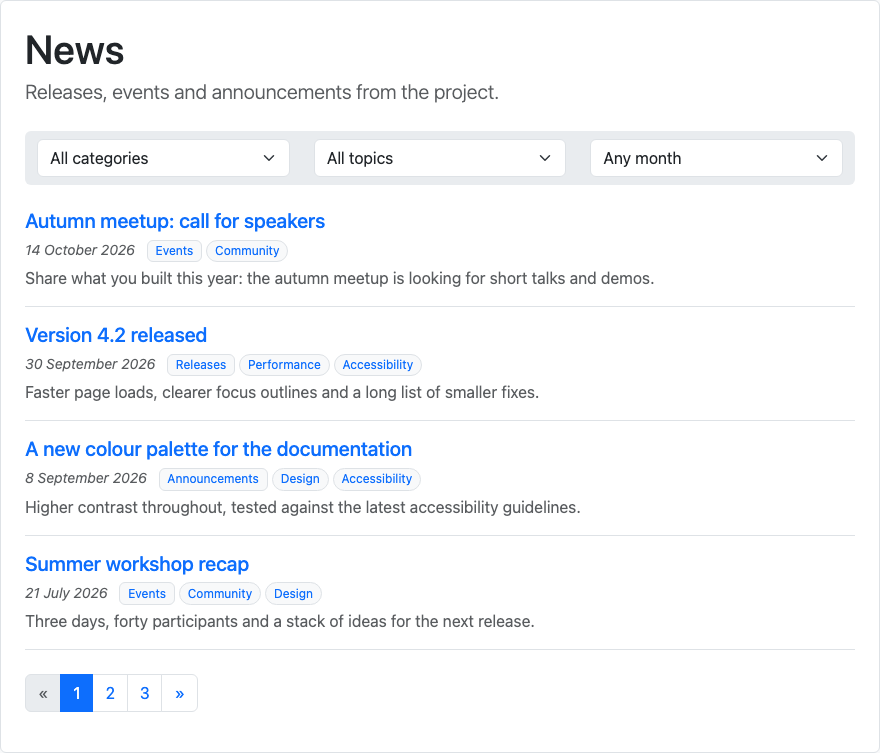
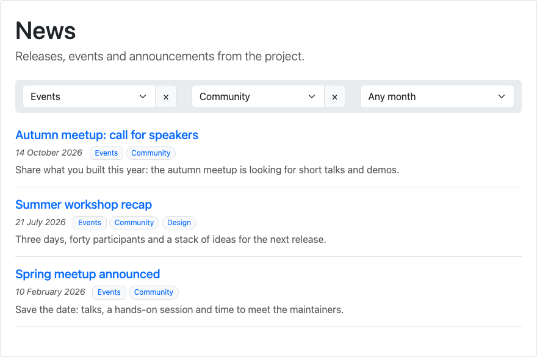
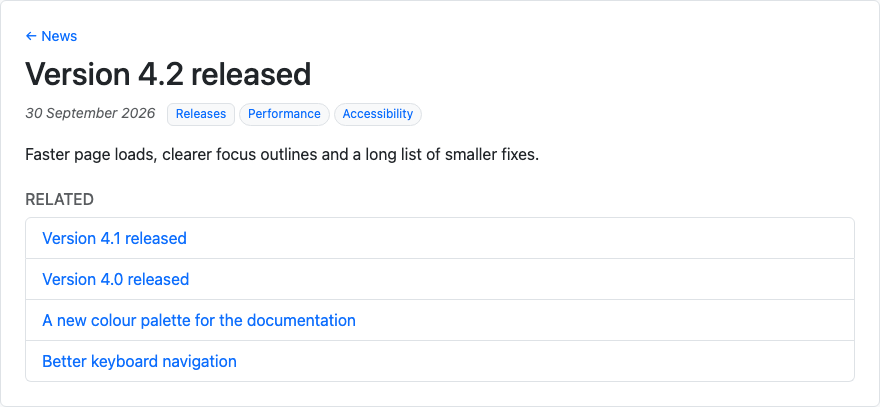
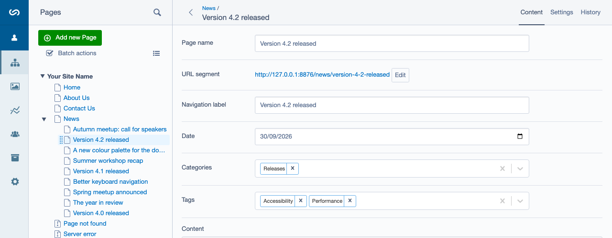

# Filterable archive for Silverstripe

Turn a page and the pages below it, such as news items or blog posts, into an archive that
visitors filter by date, category or tag. The holder page gets a filter form with one dropdown per
filter, a paginated list of the matching items, and filter links on every item, and each item page
can list its related items. Editors switch the filters on per holder page and manage its
categories and tags in the CMS. For Silverstripe 5 and 6.



*Maintained by [Restruct](https://github.com/restruct). If this module saves you time, you can
[support ongoing maintenance](https://github.com/sponsors/restruct).*

## A list of child pages is not an archive yet

Silverstripe lists the children of a page, and that is where it stops: there is no date archive,
pages have no categories or tags, and a long list has no pagination unless you build it.
[silverstripe/blog](https://github.com/silverstripe/silverstripe-blog) has categories, tags and an
archive, but only for its own `Blog` and `BlogPost` page types.

This module adds them to page types you already have, with three extensions and no page types of
its own:

- **A date archive** by year, month or day, built from the dates the items actually have
- **Categories and tags**, managed per holder page, and set on each item with a tag field
- **A filter form** with one dropdown per active filter; filters combine, and each active one has
  a link that resets it
- **Pagination** of the (filtered) list, with a plain and a Bootstrap pagination template
- **Filter links** on every item (its date, categories and tags), each leading to the holder
  filtered by it, and **filter URLs** such as `news/cat/events` or `news/date/2026-09`
- **Related items** for an item page: other items that share a tag or category with it

## Filtering by date, category and tag

### Visitors filter with dropdowns and links

Choosing an option in a dropdown submits the form at once (there is no button); an active filter
shows a reset link (x) next to its dropdown. Here the list shows the items in category Events with
the topic Community:



An item's date, categories and tags link to the holder, filtered by that category or tag. On an
item's own page, `getRelatedItems()` lists the items that share a tag or category with it:



The filter form, the item properties and the Bootstrap pagination template use Bootstrap 5 class
names (the screenshots load Bootstrap 5.3's stylesheet). Without Bootstrap they work unstyled; to
change their markup, copy a template into your theme (see [Templates](#templates)).

### Editors switch filters on per holder page

The holder page gets the settings for each filter: an "Enable" checkbox, the label of its dropdown,
the archive unit (year, month or day) for the date archive, and grids to add, rename and delete the
holder's categories and tags. A filter's settings appear once it is enabled and the page is saved.
"Pagination: items per page" sets the page length. Here they sit on a tab of their own
(`pagination_control_tab: Root.Filtering`):


Each item gets a field for its date (unless that is `Created` or `LastEdited`) and a tag field for
its categories and one for its tags, offering the holder's own, for each filter the holder has
enabled. Typing a new name in a tag field creates that category or tag on the holder:



## Technical

### Requirements

* Silverstripe CMS 5 or 6
* PHP 8.1 or newer (Silverstripe 6 itself needs 8.3)
* [silverstripe/tagfield](https://github.com/silverstripe/silverstripe-tagfield) and
  [symbiote/silverstripe-gridfieldextensions](https://github.com/symbiote/silverstripe-gridfieldextensions),
  installed automatically

### Installation

```
composer require restruct/silverstripe-filterablearchive
```

Then run `dev/build` (Silverstripe 5) or `sake db:build` (Silverstripe 6).

### Version compatibility

| Branch | Module version | Silverstripe | PHP |
|--------|----------------|--------------|-----|
| `main` | `3.1.x` | `^5 \|\| ^6` | `^8.1` |
| (tags only) | `3.0.x` | `^6` | `^8.3` |
| (tags only) | `2.0.11` | `^4 \|\| ^5` | as Silverstripe requires |
| (tags only) | `2.0` - `2.0.10` | `^4` | as Silverstripe requires |

Silverstripe 4 reached end of life in April 2025 and is no longer supported or tested here. Projects
still on it can stay on the `2.0.x` tags, which remain available.

`main` is the only maintained line (renamed from `master` at 3.1.0): it supports every Silverstripe version this module still
targets, so there is no separate maintenance branch.

**`composer.json` is the source of truth** for exact constraints; this table is a quick reference.

Upgrading from 2.0.x or 3.0.x: see the 3.1.0 entry in [CHANGELOG.md](CHANGELOG.md).

### Setup

The module has three extensions: one for the holder page (the page whose children are filtered),
one for the holder's controller, and one for the item pages below it. Apply all three, and tell the
holder which class its items are and which of their fields holds the date:

```yaml
---
Name: app-filterablearchive
---
App\PageTypes\NewsHolder:
  extensions:
    - Restruct\SilverStripe\FilterableArchive\Extensions\HolderExtension
  managed_object_class: App\PageTypes\NewsItem
  managed_object_date_field: Date
  pagination_control_tab: Root.Filtering     # optional, defaults to Root.Main
  # pagination_insert_before: Content        # optional

App\PageTypes\NewsHolderController:
  extensions:
    - Restruct\SilverStripe\FilterableArchive\Extensions\HolderControllerExtension

App\PageTypes\NewsItem:
  extensions:
    - Restruct\SilverStripe\FilterableArchive\Extensions\ItemExtension
```

Then, in the CMS, enable the date archive, categories and/or tags on the holder page and
save/publish it. Categories and tags are created on the holder (or inline, from an item's tag
field) and belong to that holder only.

[restruct/silverstripe-newsgrid](https://github.com/restruct/silverstripe-newsgrid) (manage news
items from a GridField) applies this module for you when both are installed.

### Configuration

All options are set on the **holder** class. Setting them on the holder class is what the module
reads; the defaults come from `HolderExtension`.

| Option | Default | What it does |
|---|---|---|
| `managed_object_class` | `Page` | Class of the items below the holder that are listed and filtered. |
| `managed_object_date_field` | `Created` | Field of the item that the date archive filters and sorts on (newest first). When it is not `Created` or `LastEdited`, items get an edit field for it while the holder's date archive is enabled (a date field for a `Date`, a date-and-time field for a `Datetime`). |
| `pagination_active` | `true` | Show the "items per page" field on the holder. |
| `pagination_control_tab` | `Root.Main` | CMS tab the holder's filter settings are placed on. |
| `pagination_insert_before` | not set | Name of a field on that tab to place the settings before; ignored if no such field exists. |
| `datearchive_active` | `'Date'` | A falsy value (eg `false`) switches the date archive off for the class; otherwise it is the dropdown's default label. |
| `categories_active` | `'Categories'` | Same, for categories. |
| `tags_active` | `'Tags'` | Same, for tags. |

Per holder page (CMS): the date archive, categories and tags each have an "Enable" checkbox and a
label; the date archive has a unit (year, month or day); "items per page" of `0` or empty means no
pagination.

A dropdown's label is, in order: the label set on the holder page, the argument passed in the
template (see below), the config value above.

### Templates

Include these from the holder's template (they run in the controller's scope):

```
<% include FilterableArchiveFilter %>          <%-- a form with one dropdown per active filter --%>

<% loop $PaginatedItems %>
    ...
<% end_loop %>

<% include FilterableArchivePagination %>      <%-- or FilterableArchiveBootstrapPagination --%>
```

And from an item's template (or inside a loop over items), to show its date, categories and tags:

```
<% include FilterableProperties LinkFilterProps=1 %>
```

`LinkFilterProps` links each category/tag to the holder filtered by it; `ShowDateBelow` moves the
date after them (without the time of a `Datetime`); a `DateFieldComment` method on the item, if
present, is printed next to the date (not with `ShowDateBelow`).

The active filter comes from GET parameters (`?date=2024-05&cat=press&tag=blue`, as the filter form
submits them) or from these URLs on the holder: `date/2024-05`, `cat/press`, `tag/blue`. The older
`archive/2024/05` form still works.

The four templates sit in the module's `templates/` directory. To change one, copy it to your
theme's `templates/` directory under the same name and edit it there.

### Public API

On the holder (`HolderExtension`):

| Method | Returns |
|---|---|
| `getItems()` | Unfiltered items: `managed_object_class` children of the holder, newest first. Extensions can change the list through the `updateGetItems(&$items)` hook. |
| `Categories()`, `Tags()` | The holder's categories and tags (`FilterProp` records). |
| `ArchiveActive()`, `CategoriesActive()`, `TagsActive()` | Whether that filter is switched on by config AND on the page. |
| `ArchiveFilterDropdown($label = null)` | The date dropdown, or null while the archive is off. |
| `FilterDropdown('cat'\|'tag', $label = null)` | The category or tag dropdown, or null while that filter is off. |

On the holder's controller (`HolderControllerExtension`):

| Method | Returns |
|---|---|
| `PaginatedItems()` | The filtered items, paginated by the holder's "items per page". |
| `getFilteredArchiveItems()` | The filtered items, unpaginated. A category or tag that does not exist on this holder is ignored. |
| `getFilteredDate()`, `getFilteredCatSegment()`, `getFilteredTagSegment()` | The active filter values (`yyyy[-mm[-dd]]`, or a URL segment), or null. |

On an item (`ItemExtension`):

| Method | Returns |
|---|---|
| `Categories()`, `Tags()` | The item's categories and tags (a many_many through `FilterPropRelation`). |
| `getHolderPage()` | The nearest ancestor page with `HolderExtension`, or null. |
| `getDateField()` | The item's date as a DB field object (per the holder's `managed_object_date_field`), or null without a holder. |
| `getRelatedItems()` | Other items sharing a tag or category with this one (only for filters the holder has on), each listed once. |

On a category or tag (`FilterProp`): `Title`, `URLSegment` (derived from the title on write),
`Link` (the holder, filtered by it) and `Items()` (the pages linked to it).

### Running the tests

The module cannot be tested on its own: it needs a host Silverstripe project. Require it there
through a Composer **path repository with `symlink: true`** - `/tests` is `export-ignore`, so a dist
or mirrored install contains no tests - add its test namespace to the host's `autoload-dev`
(`"Restruct\\SilverStripe\\FilterableArchive\\Tests\\": "vendor/restruct/silverstripe-filterablearchive/tests/"`),
then:

```bash
# Silverstripe 5 (PHPUnit 9) - the path must come before flush=1
vendor/bin/phpunit vendor/restruct/silverstripe-filterablearchive/tests flush=1

# Silverstripe 6 (PHPUnit 11) - a flush=1 argument is ignored, use the env var
SS_PHPUNIT_FLUSH=1 vendor/bin/phpunit vendor/restruct/silverstripe-filterablearchive/tests
```

CI runs the same suite against Silverstripe 5 and 6 (on MySQL, plus one SQLite leg each) on every
push to `main` and every pull request; see `.github/workflows/ci.yml`. Playwright browser tests of
the filter form, the listing and the CMS fields live in `tests/browser/` and run in
`.github/workflows/browser-tests.yml`. The README screenshots are generated by a script next to
them; see [tests/browser/screenshots/README.md](tests/browser/screenshots/README.md).

Changes per release: [CHANGELOG.md](CHANGELOG.md).

### License

BSD-3-Clause; see [LICENSE](LICENSE). Copyright is held by Michael van Schaik (Restruct), Itayi
Patrick Chito-voro and Bart van Irsel.
